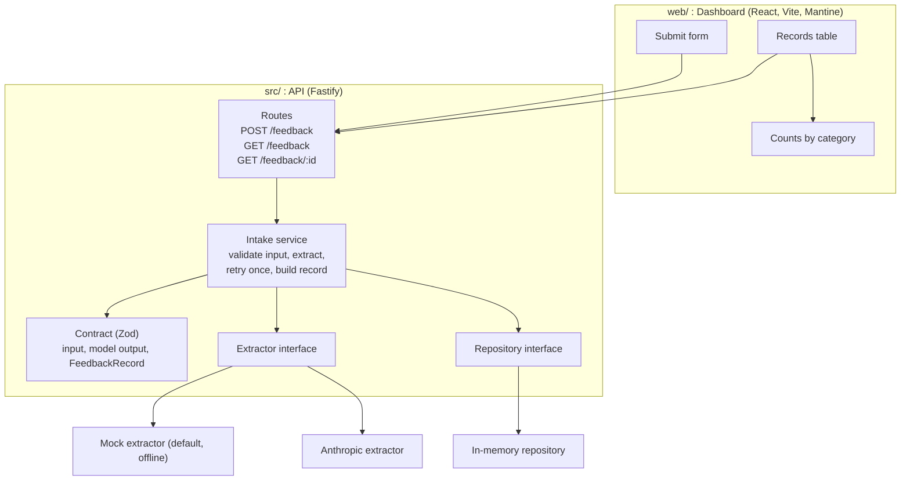
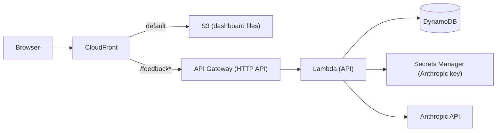

# Feedback Intake Service

A small service that turns free-text feedback into a structured record. An AI model
extracts category, sentiment, severity, summary and suggested action. The service
validates the result, stores it, and a dashboard shows the records.

Scope: [PLAN.md](PLAN.md). Limits and next steps: [HARDENING.md](HARDENING.md).
Decisions, use of AI and time spent: [DECISIONS.md](DECISIONS.md).

## Architecture

### Application



### AWS target

Described in `infra/` with AWS CDK. Not deployed. Check it with `yarn synth`.



Locally the repository is in memory. The repository interface is where DynamoDB
would plug in. The Lambda adapter for the API is not built (see `HARDENING.md`).

## What is mocked

The AI model is mocked by default so the service runs offline. The mock returns
plausible answers from simple keyword rules. The real model is used only when
`EXTRACTOR=anthropic` and an `ANTHROPIC_API_KEY` are set in a local `.env` file,
which is not committed.

## Requirements

Node 22.12 or newer and Yarn.

## Run

```
yarn install
yarn start:api   # API on http://localhost:3000 (mock model)
yarn dev:web     # dashboard on http://localhost:5173
yarn test
yarn typecheck
yarn synth       # checks the AWS CDK stack, nothing is deployed
```

To use the real model, copy `.env.example` to `.env` and set `EXTRACTOR=anthropic`
and `ANTHROPIC_API_KEY`. `PRODUCT_CONTEXT` is optional.

## API

| Call | Result |
|---|---|
| `POST /feedback` with `{ "text": "..." }` | 201 with the record |
| `GET /feedback` | list, newest first |
| `GET /feedback/:id` | the record, or 404 |

Errors look like `{ "error": { "code", "message" } }`: 400 `invalid_input`,
404 `not_found`, 502 `invalid_model_output` or `extraction_failed`, 500 `internal_error`.
